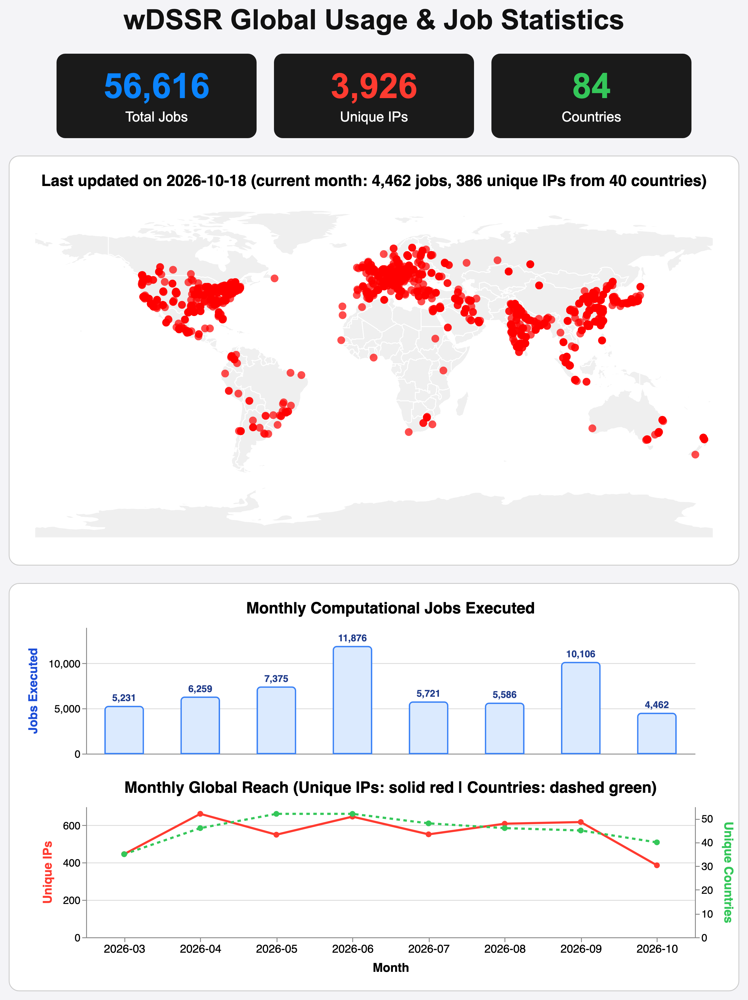

# wDSSR: Web Interface to X3DNA-DSSR

**wDSSR** (https://web.x3dna-dssr.org) is the official web interface to the X3DNA-DSSR computational suite for dissecting, modeling, and visualizing 3D nucleic acid structures. Supported by NIH/NIGMS grant R24GM153869 as a National Resource for Structural Bioinformatics of Nucleic Acids.

---

## Global Usage & Impact

First made publicly available on **March 15, 2026**, wDSSR tracks active computational jobs (excluding passive page views) executed across research institutions worldwide.

  

*As of October 18, 2026:*
* **56,600+ Computational Jobs Executed** across 84 countries.
* **3,920+ Unique IP Addresses** spanning academic, educational, and industrial research institutions.
* **Active Global Reach** across the Americas, Europe, Asia, Africa, and Oceania.

---

## The wDSSR Workflow

The platform distills the analytical and modeling capabilities of the X3DNA-DSSR engine into seven streamlined scientific modules:

1. **ANALYZE:** Comprehensive structural and conformational analysis of nucleic acids (identifying canonical and non-canonical base pairs, multiplets, pseudoknots, loops, and helical parameters).
2. **REBUILD:** Construct 3D atomic models from derived local base-pair and step parameters, with backbone stereochemistry optimization.
3. **MODEL:** Generate 56 distinct regular helical fiber models (A-DNA, B-DNA, RNA forms, Pauling triplexes) from sequence alone.
4. **CIRCULARIZE:** Generate closed-loop, continuous circular nucleic acid models.
5. **MUTATE:** Rapid *in silico* base substitutions while strictly conserving sugar-phosphate backbone geometry.
6. **ASSEMBLE:** Link duplexes and protein–nucleic acid complexes into composite higher-order architectures.
7. **VISUALIZE:** Synchronized, interactive browser visualization coupling 1D sequence, 2D secondary structure diagrams, and publication-grade 3D cartoon-block representations.

---

## Community & Support

* **Technical Exchange & Ideas:** Share workflow ideas, UI feedback, and feature requests in [GitHub Discussions — Ideas](https://github.com/x3dna-dssr/wDSSR/discussions/categories/ideas).
* **Troubleshooting & Q&A:** Ask questions about unexpected results and get help in [GitHub Discussions — Support](https://github.com/x3dna-dssr/wDSSR/discussions/categories/support).
* **Official Releases:** Track server updates and key announcements in [GitHub Discussions — Announcements](https://github.com/x3dna-dssr/wDSSR/discussions/categories/announcements).

---

## Acknowledgements

* **Developed by:** Drs. Shuxiang Li and Xiang-Jun Lu
* **With support from:** Drs. Harmen Bussemaker and Wilma Olson, and feedback from the user community.
* **Funding:** Funded by the NIH R24GM153869 grant on X3DNA-DSSR, an NIGMS National Resource for Structural Bioinformatics of Nucleic Acids.
